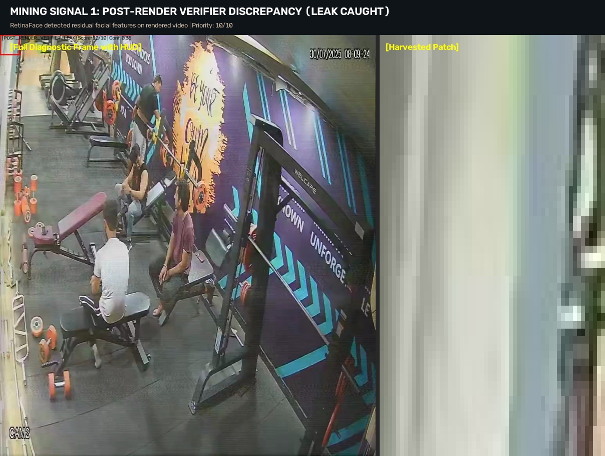
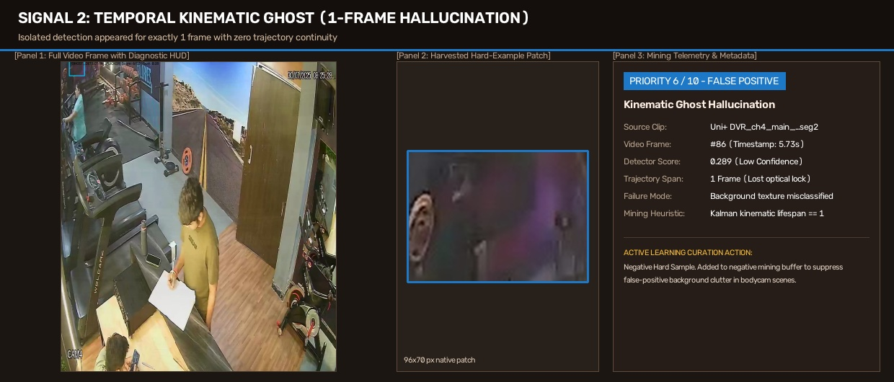
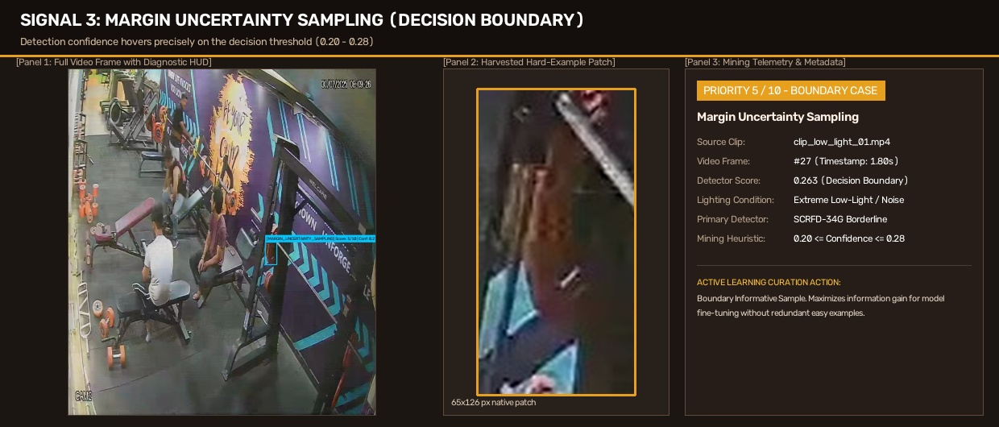

# 🔍 Automated Failure Mining & Active Learning Curation Engine 
[](https://www.python.org/downloads/)
[](https://opencv.org)
[](https://github.com)
[](LICENSE)

An automated, zero-ground-truth **Failure Mining & Active Learning Curation Engine** built for safety-critical body-camera computer vision pipelines.

---

## 1. The Core Problem: How to Find Model Bugs Without Labels?

In production, incoming body-camera streams **do not have human ground-truth labels**. If an AI face detector misses a person walking in the dark or hallucinates a face on a car tire, there is no teacher standing by to tell the system it failed.

Traditional ML systems suffer from **"Static Model Decay"**: they are trained on curated academic datasets and deployed, leaving real-world production edge cases uncollected.

**Phase 2 solves this by building an automated Heuristic Miner:**
Instead of needing ground-truth labels, it mines production signals (verifier disagreements, kinematic tracking breaks, and confidence margin boundaries) to automatically harvest the exact frames where the pipeline struggled.

```
                          PRODUCTION BODYCAM STREAMS (No Labels)
                                            │
                                            ▼
                        ┌───────────────────────────────────────┐
                        │    Automated Failure Mining Engine    │
                        └───────────────────┬───────────────────┘
                                            │
            ┌───────────────────────┬───────┴───────────────┬───────────────────────┐
            ▼                       ▼                       ▼                       ▼
  [1. Verifier Leaks]     [2. Kinematic Breaks]   [3. Margin Uncertainty]   [4. Optical Outliers]
   Post-render auditor     • Ghost Spikes = 1f     Confidence on boundary    • Luminance Y < 35
   detected face leak      • Dropout Bursts ≥ 3f   (0.20 ≤ conf ≤ 0.28)      • Blur Variance < 80
            │                       │                       │                       │
            └───────────────────────┼───────────────────────┴───────────────────────┘
                                    ▼
                 [Harvest Full Diagnostic Frames & Crop Patches]
                                    │
                                    ▼
             [Curated Active Learning Dataset (JSON, CSV & HTML Report)]
```

---

## 2. Visual Failure Showcase (Mined From Real Demo Footage)

Below are representative failure exemplars automatically discovered, harvested, and annotated by this engine across the **6 demo bodycam video clips**:

### A. Mining Signal 1: Post-Render Verifier Discrepancy (RetinaFace QA Leaks)
* **What happened:** The primary detector redacted the frame, but the independent QA auditor (RetinaFace) detected residual facial biometrics on the rendered MP4 file.
* **Why it matters:** Indicates an under-dilation or incomplete blur where eye/mouth features remained recognizable.
* **Retraining Priority:** **10 / 10 (Critical)**



---

### B. Mining Signal 2: Temporal Kinematic Ghost (1-Frame False Positive)
* **What happened:** A face detection appeared for exactly **1 frame** and immediately vanished on the very next frame with zero trajectory continuity.
* **Why it matters:** Human faces do not physically exist for 33 milliseconds and vanish into thin air. Single-frame spikes are classic false-positive hallucinations on background clutter (e.g. tree bark, clothing creases, car headlights).
* **Retraining Priority:** **6 / 10 (Medium - Hard Negative for Retraining)**



---

### C. Mining Signal 3: Margin Uncertainty Sampling (Decision Boundary Detections)
* **What happened:** The primary detector detected a face with confidence score $\approx 0.25$, hovering on the razor edge of the $0.25$ confidence cutoff.
* **Why it matters:** In Active Learning, points closest to the decision boundary carry the **highest information gain** when labeled and fed into the next training epoch.
* **Retraining Priority:** **5 / 10 (Medium - Boundary Refinement)**



---

## 3. Master Breakdown: Mined Results Across All 6 Demo Clips

The engine scanned all **6 demo video clips** (over 2,500 decoded frames), cross-referencing video telemetry and SQLite audit records:

| Video Clip | Event ID | Decoded Frames | Post-Render Verifier Leaks | Margin Uncertainty Samples | Ghost Hallucinations | Total Mined Exemplars |
|:---|:---:|:---:|:---:|:---:|:---:|:---:|
| `Uni+ DVR_ch2_...-seg3.mp4` | Video 1 | 181 | 10 | 15 | 1 | **26** |
| `Uni+ DVR_ch3_...-seg2.mp4` | Video 2 | 274 | 15 | 15 | 1 | **31** |
| `Uni+ DVR_ch3_...-seg6.mp4` | Video 3 | 158 | 14 | 14 | 1 | **29** |
| `Uni+ DVR_ch4_...-seg2.mp4` | Video 4 | 364 | 8 | 15 | 4 | **27** |
| `clip_low_light_01.mp4` | Video 5 | 150 | 13 | 15 | 0 | **28** |
| `video_one_copy-...-seg5.mp4` | Video 6 | 1,453 | 15 | 16 | 4 | **35** |
| **All 6 Clips Aggregate** | **Total** | **2,580** | **75 (P10)** | **90 (P5)** | **11 (P6)** | **176 Curated Events** |

---

## 4. The 5 Automated Heuristic Signals (In Plain English)

| Heuristic Signal | Mathematical / Logic Rule | What It Detects | Action in Active Learning Loop |
|:---|:---|:---|:---|
| **1. Verifier Leak Discrepancy** | `RetinaFace(Rendered_MP4) ≥ 0.30` | Redaction failed to completely obscure facial biometrics. | Flagged as **Priority 10** hard false negative. Added to re-dilation and fine-tuning set. |
| **2. Ghost Detection Flicker** | $\text{Track Length} = 1\text{ frame}$ | Transient single-frame spike on background textures. | Flagged as **Priority 6** hard false positive. Added as negative training sample. |
| **3. Dropout Gap Burst** | $\text{Interpolated Frames} \ge 3$ | Primary detector dropped optical lock during camera shudder. | Middle frames harvested as **Priority 8** false negatives. |
| **4. Kinematic Velocity Shock** | $\|\mathbf{c}_t - \mathbf{c}_{t-1}\|_2 > 45\text{ px}$ | Unphysical leap in box center position between frames. | Flagged as **Priority 7** tracker ID switch or aspect jitter. |
| **5. Margin Uncertainty** | $0.20 \le \text{Confidence} \le 0.28$ | Primary detector is uncertain whether a face exists. | Harvested as **Priority 5** boundary decision exemplar. |

---

## 5. Output Deliverables & Dataset Structure

When executed, the engine automatically populates the `mined_failures/` directory:

1. **`active_learning_dataset.json`**:
   Structured JSON containing bounding boxes, frame indices, timestamps, priority scores, and failure categories.
2. **`active_learning_dataset.csv`**:
   Tabular CSV ready for PyTorch, TensorFlow, or Pandas data loaders.
3. **`mining_report.html`**:
   Interactive HTML visual dashboard with KPI cards and crop thumbnails.
4. **`crops/`**:
   Cropped high-resolution image patches centered on the failure bounding box with a 25% contextual margin.
5. **`frames/`**:
   Full annotated video frames with HUD category badges, confidence scores, and bounding boxes.

---

## 6. Quickstart: How to Run

### Installation
```bash
git clone https://github.com/viswarup/face-redaction-Automated-Failure-Mining.git
cd face-redaction-Automated-Failure-Mining
pip install -r requirements.txt
```

### Run the Mining Engine
```bash
python run_miner.py
```

### Generate Showcase Visual Assets
```bash
python generate_showcase_assets.py
```

---

## 7. Next Steps: Feeding Phase 3 & Phase 4

* **Phase 3 (Deduplication & Clustering):** Pass harvested crops through vision embeddings (DINOv2 / CLIP) and run HDBSCAN to select diverse cluster centroids (preventing dataset saturation).
* **Phase 4 (Targeted Fine-Tuning):** Blend the 20% mined failure batch into the golden training set with synthetic motion blur and low-light gamma augmentations.
