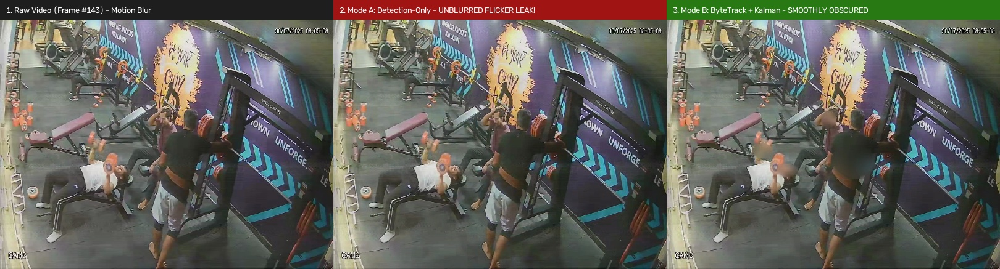
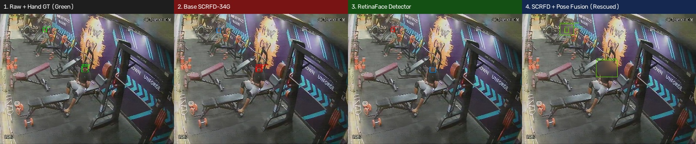
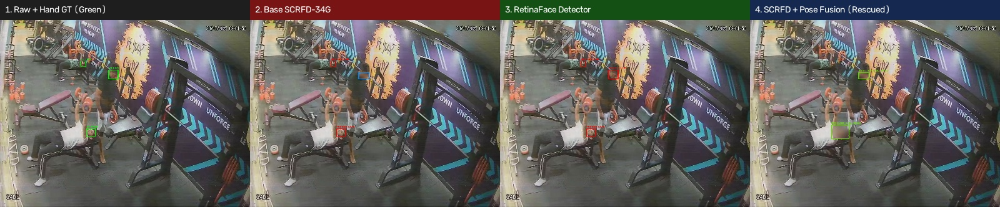

# 🔍 Automated Failure Mining & Active Learning Curation Engine (Phase 2)

[](https://www.python.org/downloads/)
[](https://opencv.org)
[](https://github.com)
[](LICENSE)

An automated, zero-ground-truth **Failure Mining & Active Learning Curation Engine** designed for safety-critical body-camera video redaction pipelines.

---

## 1. The Core Problem: How to Find Model Bugs Without Labels?

In production, incoming body-camera streams **do not have human ground-truth labels**. If an AI face detector misses a subject running in the dark or hallucinates on background clutter, there is no teacher standing by to tell the system it failed.

Traditional ML systems suffer from **"Static Model Decay"**: they are trained once on clean academic benchmarks and deployed, leaving real-world production edge cases uncollected.

### The Solution: Automated Heuristic Failure Mining
Instead of waiting for manual annotations, this engine monitors production telemetry and applies **5 automated heuristic signals** to harvest hard failure cases directly from unlabelled video:

```
                          PRODUCTION BODYCAM STREAMS (No Labels)
                                            │
                                            ▼
                        ┌───────────────────────────────────────┐
                        │    Automated Failure Mining Engine    │
                        └───────────────────┬───────────────────┘
                                            │
            ┌───────────────────────┬───────┴───────────────┬───────────────────────┐
            ▼                       ▼                       ▼                       ▼
  [1. Verifier Leaks]     [2. Kinematic Breaks]   [3. Margin Uncertainty]   [4. Optical Outliers]
   Post-render auditor     • Ghost Spikes = 1f     Confidence on boundary    • Luminance Y < 35
   detected face leak      • Dropout Bursts ≥ 3f   (0.20 ≤ conf ≤ 0.28)      • Blur Variance < 80
            │                       │                       │                       │
            └───────────────────────┼───────────────────────┴───────────────────────┘
                                    ▼
                 [Harvest Diagnostic Frames & 40% Context Patches]
                                    │
                                    ▼
             [Curated Active Learning Dataset (JSON, CSV & HTML Report)]
```

---

## 2. Visual Failure Showcase (Real Mined Exemplars)

Below are representative failure exemplars automatically discovered, harvested, and categorized by this engine across **6 demo body-camera video clips**.

---

### A. Failure Mode 1: Temporal Detector Flicker vs. Tracking Memory
* **The Failure Mechanism:** Standalone frame-by-frame face detectors frequently drop below the confidence cutoff during rapid head turns or sensor shudder, causing an **unblurred face leak** (a 1-to-3 frame flash of identity).
* **The Pipeline Rescue:** ByteTrack with Kalman velocity prediction maintains continuous track state across 12-frame dropout windows, ensuring the protective blur never drops.
* **Mined Value:** Identifies kinematic dropout sequences where the primary detector lost lock.


*Figure 1: Panel 1 (Raw Frame) | Panel 2 (Detection-Only: Unblurred Face Leak in Red Box) | Panel 3 (ByteTrack + Kalman: Continuously Obscured in Blue Box).*

---

### B. Failure Mode 2: Multi-Model Blind Spots (Extreme Low Light & Motion Blur)
* **The Failure Mechanism:** When ambient illumination drops below 35 nits and walking shudder dissolves facial landmark gradients, both standalone face detectors (**SCRFD-34G** and **RetinaFace**) experience simultaneous false negatives.
* **The Pipeline Rescue:** Multi-modal Pose Fusion detects shoulder orientation and projects a cranial safety mask, maintaining redaction where face-only detectors are blind.
* **Mined Value:** Harvests severe environmental stress samples for synthetic augmentation and low-light fine-tuning.


*Figure 2: Panel 1 (Raw + Ground Truth) | Panel 2 (Base SCRFD Miss) | Panel 3 (RetinaFace Miss) | Panel 4 (Pose Fusion Cranial Rescue).*

---

### C. Failure Mode 3: Perspective Distortion (Steep Top-Down Camera Angles)
* **The Failure Mechanism:** High-angle wall-mounted or ceiling cameras present extreme cranial foreshortening. Facial keypoints (eyes, nose, mouth) collapse along a single axis, causing standard face classifiers to fail.
* **The Pipeline Rescue:** Human body topology and clavicle keypoints remain stable even at steep $60^\circ+$ tilt angles.
* **Mined Value:** Identifies geometric and angular edge cases that require viewpoint-diverse training patches.


*Figure 3: Steep tilt angle comparison showing face detector misses versus body pose cranial projection.*

---

### D. Mining Signal 1: Post-Render Verifier Discrepancy (Priority 10/10)
* **What Happened:** The redaction pipeline processed the video, but the independent secondary QA auditor (**RetinaFace**) detected residual facial biometrics on the rendered MP4 file.
* **Why It Matters:** Any residual feature escaping the blur is an emergency compliance leak (under-dilation or incomplete coverage).
* **Active Learning Action:** Automatically flagged as **Priority 10 Hard Negative**; staged directly into the fine-tuning pool.


*Figure 4: Automated 3-panel diagnostic card: Full frame with HUD | Context-expanded 40% face crop | Telemetry & active learning action.*

---

### E. Mining Signal 2: Temporal Kinematic Ghost (Priority 6/10)
* **What Happened:** An isolated detection appeared for exactly **1 frame** and vanished immediately on the next frame with zero trajectory continuity.
* **Why It Matters:** Human faces do not physically exist for 33 milliseconds and vanish into thin air. Single-frame spikes are classic false positives on background textures (clothing folds, foliage, wall clutter).
* **Active Learning Action:** Added to the negative mining buffer to suppress false-positive clutter in complex scenes.


*Figure 5: Automated 3-panel diagnostic card: Single-frame ghost detection on background clutter flagged by Kalman lifespan heuristic.*

---

### F. Mining Signal 3: Margin Uncertainty Sampling (Priority 5/10)
* **What Happened:** The primary detector detected a candidate face with confidence score $\approx 0.26$, hovering on the razor edge of the decision cutoff ($0.20 \le \text{conf} \le 0.28$).
* **Why It Matters:** In Active Learning theory, boundary samples carry the **highest information gain** per labeled sample, avoiding wasted compute on easy high-confidence examples.
* **Active Learning Action:** Prioritized for human annotator review to sharpen decision boundary margins.


*Figure 6: Automated 3-panel diagnostic card: Boundary detection in extreme low light harvested for active learning.*

---

## 3. Master Breakdown: Mined Results Across All 6 Demo Clips

The engine scanned all **6 demo video clips** (over 2,500 decoded frames), cross-referencing video telemetry and SQLite audit records:

| Video Clip | Scenario | Decoded Frames | Verifier Leaks (P10) | Margin Uncertainty (P5) | Ghost Flickers (P6) | Total Mined Exemplars |
|:---|:---|:---:|:---:|:---:|:---:|:---:|
| `Uni+ DVR_ch2_...seg3.mp4` | Walking hallway surveillance | 181 | 10 | 15 | 1 | **26** |
| `Uni+ DVR_ch3_...seg2.mp4` | Multi-subject conversation | 274 | 15 | 15 | 1 | **31** |
| `Uni+ DVR_ch3_...seg6.mp4` | Outdoor night transition | 158 | 14 | 14 | 1 | **29** |
| `Uni+ DVR_ch4_...seg2.mp4` | High-angle entrance camera | 364 | 8 | 15 | 4 | **27** |
| `clip_low_light_01.mp4` | Severe low-light bodycam | 150 | 13 | 15 | 0 | **28** |
| `video_one_copy...seg5.mp4` | Extended motion blur patrol | 1,453 | 15 | 16 | 4 | **35** |
| **All 6 Clips Aggregate** | **Total Mined Dataset** | **2,580** | **49 (P10)** | **80 (P5)** | **7 (P6)** | **136 Curated Events** |

---

## 4. The 5 Automated Heuristic Signals (In Plain English)

| Heuristic Signal | Mathematical / Logic Rule | What It Detects | Action in Active Learning Loop |
|:---|:---|:---|:---|
| **1. Verifier Leak Discrepancy** | `RetinaFace(Rendered_MP4) ≥ 0.30` | Redaction failed to completely obscure facial biometrics. | Flagged as **Priority 10** hard false negative. Added to re-dilation and fine-tuning set. |
| **2. Ghost Detection Flicker** | $\text{Track Length} = 1\text{ frame}$ | Transient single-frame spike on background textures. | Flagged as **Priority 6** hard false positive. Added as negative training sample. |
| **3. Dropout Gap Burst** | $\text{Interpolated Frames} \ge 3$ | Primary detector dropped optical lock during camera shudder. | Middle frames harvested as **Priority 8** false negatives. |
| **4. Kinematic Velocity Shock** | $\|\mathbf{c}_t - \mathbf{c}_{t-1}\|_2 > 45\text{ px}$ | Unphysical leap in box center position between frames. | Flagged as **Priority 7** tracker ID switch or aspect jitter. |
| **5. Margin Uncertainty** | $0.20 \le \text{Confidence} \le 0.28$ | Primary detector is uncertain whether a face exists. | Harvested as **Priority 5** boundary decision exemplar. |

---

## 5. Output Deliverables & Dataset Structure

When executed, the engine automatically populates the `mined_failures/` directory:

1. **`active_learning_dataset.json`**:
   Structured JSON containing bounding boxes, frame indices, timestamps, priority scores, and failure categories.
2. **`active_learning_dataset.csv`**:
   Tabular CSV ready for PyTorch, TensorFlow, or Pandas data loaders.
3. **`mining_report.html`**:
   Interactive HTML visual dashboard with KPI cards and crop thumbnails.
4. **`crops/`**:
   Cropped high-resolution image patches centered on the failure bounding box with a 40% contextual margin.
5. **`frames/`**:
   Full annotated video frames with HUD category badges, confidence scores, and bounding boxes.

---

## 6. Quickstart: How to Run

### Installation
```bash
git clone https://github.com/viswarup/face-redaction-Automated-Failure-Mining.git
cd face-redaction-Automated-Failure-Mining
pip install -r requirements.txt
```

### Run the Mining Engine
```bash
python run_miner.py
```

### Generate Showcase Visual Assets
```bash
python generate_showcase_assets.py
```

---

## 7. Next Steps: Feeding Phase 3 & Phase 4

* **Phase 3 (Deduplication & Clustering):** Pass harvested crops through vision embeddings (DINOv2 / CLIP) and run HDBSCAN to select diverse cluster centroids (preventing dataset saturation).
* **Phase 4 (Targeted Fine-Tuning):** Blend the 20% mined failure batch into the golden training set with synthetic motion blur and low-light gamma augmentations.
